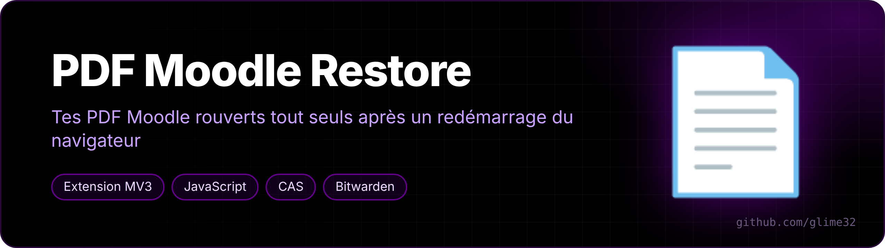
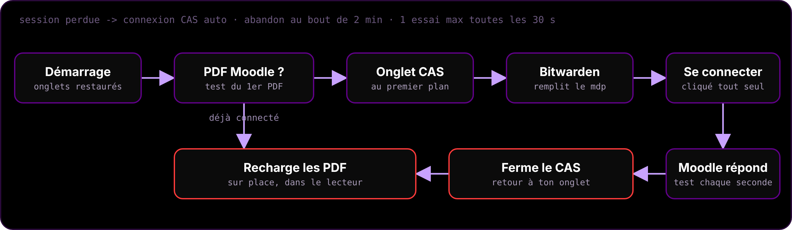

<p align="center"></p>

<p align="center">   </p>

<p align="center"><a href="README.md">🇬🇧 English version</a></p>

**Tes PDF Moodle rouverts tout seuls après un redémarrage du navigateur.** Pour [Helium](https://github.com/imputnet/helium) ou tout navigateur Chromium avec l'extension *PDF Viewer* (pdf.js), sur le Moodle de l'Université de Montpellier.

## Le problème

Après un redémarrage, le navigateur restaure les onglets PDF Moodle… mais la session Moodle est perdue. Le lecteur PDF reçoit la page de connexion au lieu du PDF, donc tous les onglets sont vides.

## Ce que fait l'extension

<p align="center"></p>

Au démarrage, si des PDF Moodle sont ouverts et que tu n'es plus connecté :

1. elle ouvre la connexion CAS de Moodle au premier plan ;
2. Bitwarden remplit l'identifiant et le mot de passe, l'extension clique sur « Se connecter » ;
3. dès que Moodle renvoie un PDF, elle ferme l'onglet CAS, **revient sur ton onglet** et recharge les PDF sur place.

**Aucun mot de passe n'est stocké par l'extension** : c'est Bitwarden qui remplit. Garde-fous : un essai de connexion max toutes les 30 s (pas de spam si le mot de passe est faux), abandon au bout de 2 minutes, et la page CAS est rechargée si le Wi-Fi n'était pas encore prêt au démarrage.

## Installation

```bash
curl -fsSL https://raw.githubusercontent.com/glime32/pdf-moodle-restore/main/install.sh | bash
```

Puis, **la première fois seulement** : `chrome://extensions` → Mode développeur → Charger l'extension non empaquetée → `~/extensions/pdf-fix`.

**Réglages Bitwarden** : Remplissage automatique → *Remplissage automatique au chargement de la page* activé ; Sécurité → *Délai d'expiration du coffre* : Jamais (sinon le coffre est verrouillé au démarrage).

## Mises à jour

`install.sh` crée un timer systemd utilisateur qui fait `git pull` à l'ouverture de session puis toutes les heures. L'extension voit la nouvelle version sur le disque et se recharge toute seule.

```bash
systemctl --user status pdf-moodle-restore-maj.timer
```

## Désinstaller

```bash
systemctl --user disable --now pdf-moodle-restore-maj.timer
rm ~/.config/systemd/user/pdf-moodle-restore-maj.*
rm -rf ~/extensions/pdf-fix
```

Puis retirer l'extension dans `chrome://extensions`. Pour une autre université : changer l'adresse de Moodle dans `background.js` et `manifest.json`, et le texte du bouton CAS dans `login.js`.
