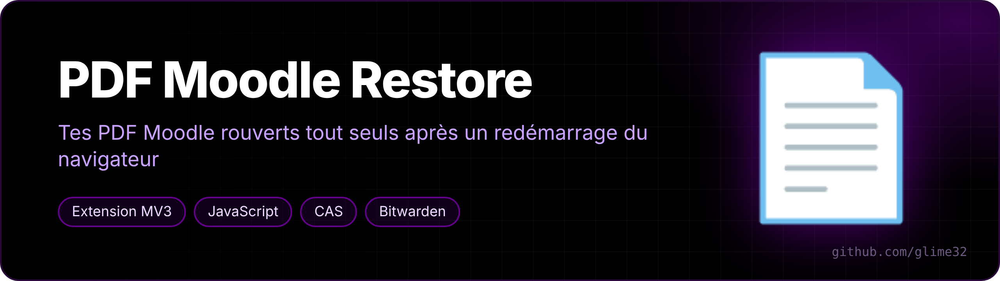
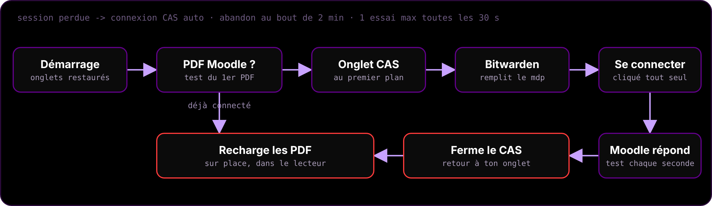

<p align="center"></p>

<p align="center">   </p>

<p align="center"><a href="README.fr.md">🇫🇷 Version française</a></p>

**Brings your Moodle PDFs back after a browser restart.** For [Helium](https://github.com/imputnet/helium) or any Chromium browser using the *PDF Viewer* (pdf.js) extension, on Université de Montpellier's Moodle.

## The problem

After a restart, the browser restores your Moodle PDF tabs — but the Moodle session is gone. The PDF viewer gets the login page instead of the file, so every tab is blank.

## What it does

<p align="center"></p>

When the browser starts, if Moodle PDFs are open and you're logged out:

1. it opens Moodle's CAS login in a foreground tab;
2. your password manager (Bitwarden) fills in the credentials and the extension clicks *Se connecter*;
3. as soon as Moodle serves a PDF again, it closes the CAS tab, **brings you back to your tab** and reloads every PDF in place.

**No password is stored by the extension** — the password manager does the filling. Safety nets: one login attempt per 30 s max (no spamming with a wrong password), gives up after 2 minutes, retries the CAS page if Wi-Fi wasn't ready yet at boot.

## Install

```bash
curl -fsSL https://raw.githubusercontent.com/glime32/pdf-moodle-restore/main/install.sh | bash
```

Then, **the first time only**: `chrome://extensions` → Developer mode → *Load unpacked* → `~/extensions/pdf-fix`.

**Bitwarden settings**: Autofill → *Autofill on page load* on; Security → *Vault timeout*: Never (otherwise the vault is locked at startup).

## Updates

`install.sh` sets up a systemd user timer that runs `git pull` at login and every hour. The extension notices the new version on disk and reloads itself.

```bash
systemctl --user status pdf-moodle-restore-maj.timer
```

## Uninstall

```bash
systemctl --user disable --now pdf-moodle-restore-maj.timer
rm ~/.config/systemd/user/pdf-moodle-restore-maj.*
rm -rf ~/extensions/pdf-fix
```

Then remove the extension in `chrome://extensions`. For another university, change the Moodle URL in `background.js`, `manifest.json` and the CAS button text in `login.js`.
